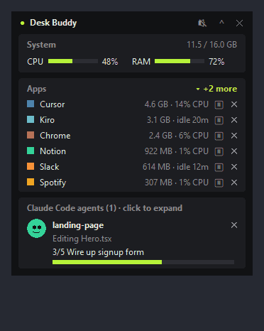
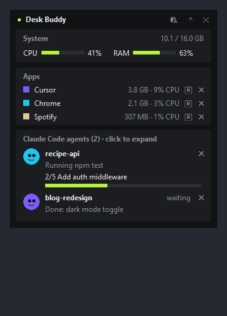
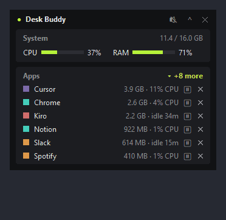
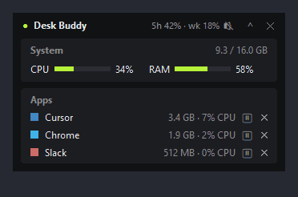
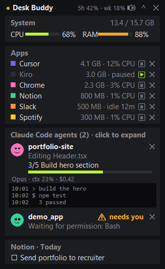
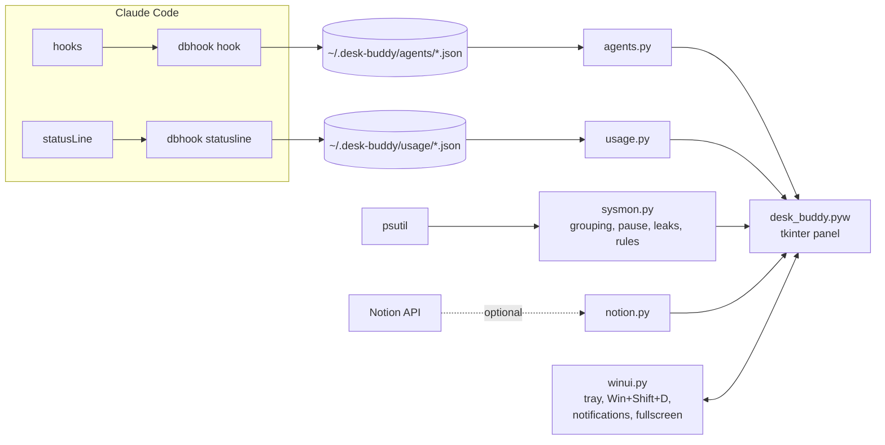

# Desk Buddy

**Task Manager is too big. Desk Buddy is a sticky note that keeps your laptop alive while AI agents work.**



[](#download)
[](#run-from-source)
[](LICENSE)
[](https://github.com/Yashgurav002/desk-buddy/releases/latest)

A 340 px always-on-top panel: CPU, RAM, the apps actually eating it (grouped, with pause and close), and a live card for every Claude Code session. Under 50 MB RAM, no server, nothing leaves your machine.

## Download

1. Grab **`DeskBuddy-v2.0.0-windows.zip`** from [the latest release](https://github.com/Yashgurav002/desk-buddy/releases/latest).
2. Unzip it anywhere you'll keep it (e.g. `C:\Tools\DeskBuddy\`) and run **`DeskBuddy.exe`**.
3. Windows shows *"Windows protected your PC"* because the exe isn't code-signed. Click **More info → Run anyway**.

First launch sets itself up, once:
- adds Desk Buddy to Startup (starts at login) and to the Start Menu;
- if you use Claude Code (`~/.claude` exists), adds its hooks and a `statusLine` to `~/.claude/settings.json`, pointing at `dbhook.exe`. Your existing keys and hooks are kept, and `settings.json.bak` is written first;
- shows one notification: *"Desk Buddy installed - starts at login"*.

Restart open Claude Code sessions so they pick up the hooks. To remove everything it added: `DeskBuddy.exe --uninstall`.

## What it does

**Agents.** One card per Claude Code session: working, waiting or ⚠ needs you, with todo progress. Click a card for a terminal-style log of what it just did, plus model, context % and cost. A Windows notification fires when an agent needs you.



**Apps.** Processes grouped into apps (Cursor plus its 20 `node.exe` helpers is one row). ⏸ pauses an app (frees its CPU, resumed when you click ▶ or quit Desk Buddy), ✕ closes it after a confirm. `+N more` expands the list; the mouse wheel scrolls it.



**Usage limits.** `5h 42% · wk 18%` for your Claude plan, amber at 80%, red at 95%. Click it for reset times. Collapse the panel with `^` and the header still shows `CPU · RAM · 5h`.



**Warnings before the freeze.** RAM held at 85%+ gets an amber banner naming the app to close (idle ones first). An app that grows 1 GB+ in 30 min gets a leak warning. A heavy app opening gets a toast.

**Stays out of the way.** Hides in fullscreen apps, hides to the tray, toggles with **Win+Shift+D**, drags anywhere and remembers where.



## If you closed it

The header ✕ only hides the panel.

| You did | Get it back |
|---|---|
| Clicked ✕ | Click the lime dot in the tray (near the clock) |
| Lost it behind something | Press **Win+Shift+D** |
| Chose **Quit** from the tray menu | Type "Desk Buddy" in Start |

Paused apps are resumed when Desk Buddy quits, and on the next start if it crashed.

## Claude Code integration

Claude Code runs `dbhook.exe hook` on prompt, tool-use, stop and notification events, and `dbhook.exe statusline` for the status line.
Each call writes one small JSON file under `~/.desk-buddy/` and exits; the panel reads those files every 2 s.
No API keys, no network, no transcript upload. If you already have a `statusLine`, it is left alone (you just won't get the usage pill).

## config.json

Optional, at `~/.desk-buddy/config.json`. Every key is optional.

```json
{
  "rules": [
    {"if_ram_over": 90, "app": "Kiro", "idle_min": 30, "action": "pause"}
  ],
  "notion_token": "secret_...",
  "notion_db_id": "<database id>"
}
```

| Key | Meaning |
|---|---|
| `rules` | Auto-rules, none by default. When RAM is over `if_ram_over` % and `app` is running (and idle `idle_min` minutes, if given), do `"pause"` or `"close"`. Each rule fires at most once per 10 min per app, with a toast. |
| `notion_token`, `notion_db_id` | Shows up to 5 Notion items due today or overdue. Env vars `NOTION_TOKEN` / `NOTION_DB_ID` also work. Create an integration at notion.so/my-integrations and share the database with it. It needs a date property; a checkbox or Done/Complete status hides finished items. |

## Run from source

Python 3.11 on Windows.

```
git clone https://github.com/Yashgurav002/desk-buddy
cd desk-buddy
pip install -r requirements.txt
python install.py
```

`install.py` adds the same Startup/Start Menu shortcuts and Claude Code hooks as the exe, but pointing at `hook.py` / `statusline.py`. Then double-click `desk_buddy.pyw`. Only one instance runs.

Tests: run each `python test_*.py` (temp folders via `DESK_BUDDY_HOME`, only processes they spawn). `python desk_buddy.pyw --selftest` renders the panel with fake data. The GIFs above are recorded from the real panel by [`docs/make_gifs.py`](docs/make_gifs.py). Build the exe with `build_exe.ps1` (needs `pyinstaller`).

## Uninstall

- Exe: `DeskBuddy.exe --uninstall`, then delete the folder.
- Source: `python install.py --uninstall`.

Both remove only what they added: their hook entries, their own `statusLine`, both shortcuts. Optionally delete `~/.desk-buddy/` (position, agent and usage files, config).

## Privacy

100% local. Desk Buddy reads process info from your own machine and the JSON files its hooks write under `~/.desk-buddy/`. The only network call is the optional Notion fetch, and only if you configure it. No telemetry, no accounts.

## Architecture



The hooks write files and exit; the panel polls them plus `psutil` every 2 s. No server, no background service.

## How it was built

Built with [Claude Code](https://claude.com/claude-code), spec first:

1. **[PRD.md](PRD.md)**: the problem (16 GB laptop, Cursor + Kiro at 95% RAM, Task Manager always open), goals, success criteria, and the v2 rule: *not overwhelming*.
2. **[TASKS.md](TASKS.md)**: the PRD split into tasks with exact file ownership, function signatures and data shapes, so agents can work in parallel without colliding.
3. **Multi-agent harness**: an orchestrator script runs parallel worker agents in waves (modules, then UI, then integration). A tester agent checks each worker's output against its acceptance checkboxes and sends failures back to that worker, up to 3 rounds.

## License

MIT, see [LICENSE](LICENSE).
